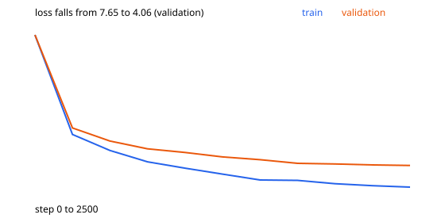

# Sports Play-by-Play Generator

[](https://ask.thili.ai/b/z28qmr8v96)
[](https://github.com/CS1411/sports-play-by-play-generator/actions/workflows/ci.yml)

[](LICENSE)

A command-line assistant for sports fans that continues a headline or a sentence into a short news-style snippet, for example for a fictional game. Everything is built from scratch in PyTorch: a **byte-pair tokenizer**, **causal self-attention**, the **transformer block**, the **GPT**, the **training loop** and **sampling**. The model is trained on 2,227 real sports news articles from Wikinews and runs on a laptop CPU, with no API keys and no pretrained weights.

```console
$ python -m app.cli play --home "Riverside FC" --away "Harbor United" --event "a late penalty decides the match" --seed 7
Riverside FC and Harbor United: a late penalty decides the match
Twood has been unable to be in the opening match. The draw was held in the second quarter of the second half, and the second half ended with a penalty kick.
```

This is a ~1M-parameter model trained for 15 minutes, so it learns the *style* of sports news (match, half, penalty kick, announced signing...) far better than it learns facts. See [Limitations](#limitations).

## Contents

- [Quick start](#quick-start)
- [Usage](#usage)
- [How it works](#how-it-works)
- [Data](#data)
- [Results](#results)
- [Reproduce it](#reproduce-it)
- [Project structure](#project-structure)
- [Testing](#testing)
- [Limitations](#limitations)
- [License and attribution](#license-and-attribution)

## Quick start

Requires Python 3.12 and git. The trained model (4.6 MB) is in the repo, so there is nothing to download or train first.

```bash
git clone https://github.com/CS1411/sports-play-by-play-generator.git
cd sports-play-by-play-generator
python -m venv .venv
source .venv/bin/activate      # Windows: .venv\Scripts\activate
pip install -r requirements.txt
python -m app.cli generate "Manchester United beat Real Madrid 2-1 in the Champions League final"
```

## Usage

```bash
python -m app.cli hello                                   # check that everything is wired up
python -m app.cli generate "Local team wins the championship"   # continue a prompt
python -m app.cli generate                                # interactive: type a prompt, get commentary
python -m app.cli play --home "Riverside FC" --away "Harbor United" --event "a late penalty decides the match"
python -m app.cli generate "The home side scored" --save snippets.txt   # append the result to a file
```

| Option | Meaning | Default |
|---|---|---|
| `--max-tokens` | How many tokens to generate | 60 |
| `--temperature` | Below 1 is safer and more repetitive, above 1 wilder. 0 always picks the likeliest token | 0.8 |
| `--top-k` | Sample only from the k most likely tokens | 40 |
| `--top-p` | Sample only from the smallest set of tokens whose probabilities add up to p | 0.9 |
| `--seed` | Fix the randomness to repeat a result | random |
| `--save FILE` | Append the commentary to a file | off |
| `--model-dir` | Folder with `gpt.pt` and `bpe.json` | `model/` |

The model was trained on articles that start with a headline, so a headline makes the best prompt; `play` builds one from the home team, away team and event.

## How it works

```text
news articles -> clean text -> byte-pair tokens -> token + position embeddings
              -> 4 transformer blocks (causal self-attention + feed-forward) -> next-token logits -> sample
```

| Milestone | What was built | Where |
|---|---|---|
| 1. Corpus | Fetch sports articles from Wikinews, convert the wikitext to plain text, clean and de-duplicate | `app/corpus.py` |
| 2. Tokenizer and embeddings | Byte-pair encoding from scratch (2,048 tokens), learned token and positional embeddings | `app/bpe.py`, `app/embeddings.py` |
| 3. Attention and blocks | Multi-head causal self-attention written out by hand (no `nn.MultiheadAttention`), the pre-norm transformer block and the GPT | `app/model.py` |
| 4. Training | Next-token cross-entropy, AdamW, warm-up and cosine learning rate, gradient clipping, held-out validation | `app/train.py` |
| 5. Generation | Temperature, top-k and top-p (nucleus) sampling, stopping at end-of-text, trimming to a full sentence | `app/generate.py` |
| 6. Command line | `generate` and `play` commands, interactive mode, options and saving to a file | `app/cli.py` |

Some details worth knowing:

- **Byte-pair encoding** starts from the 256 byte values and repeatedly merges the most frequent adjacent pair into a new token, 1,791 times. Because it works on bytes, nothing is ever "unknown", and decoding gives back exactly the text that was encoded.
- **Causal self-attention** scores each token's query against every key, divides by the square root of the head size, sets the scores of later positions to minus infinity so a token cannot see the future, and takes a softmax-weighted sum of values. A test checks that changing a later token never changes earlier predictions.
- **Weight tying**: the output layer shares its weights with the token embedding table.

## Data

The corpus is **2,227 real sports news articles from [Wikinews](https://en.wikinews.org)** (category *Sports*), 4.2 million characters, licensed CC BY 2.5. It is committed as `corpus/sports_news.txt`, and `corpus/SOURCES.tsv` lists every article with its URL.

Preparation (`app/corpus.py`): fetch each article's wikitext through the public API; keep the displayed text of inline templates such as `{{w|Gary Neville}}` and drop other templates, references, images and link sections; straighten quotes and dashes and keep plain ASCII; drop articles under 600 characters and duplicates; separate articles with an end-of-text marker so the model learns where one ends.

## Results

| | |
|---|---|
| Tokenizer | 2,048 tokens, **3.08 characters per token**, exact round trip (`docs/tokenizer.md`) |
| Corpus in tokens | 1,377,928 tokens (1,240,135 train, 137,793 validation) |
| Model | 1,071,872 parameters: 4 layers, 4 heads, 128-d embeddings, context of 128 tokens |
| Training | 2,500 steps of 32 sequences, about 15 minutes on a CPU (`docs/training_log.txt`) |
| Loss | **4.06 on held-out text, a perplexity of 58**, against 7.63 (perplexity 2,048) for random guessing |
| Memorisation | About 1% of generated 8-token runs appear word for word in the corpus (`docs/samples.md`) |



Perplexity can be read as how many tokens the model is torn between at each step, so the trained model is choosing among about 58 likely tokens instead of 2,048. Training loss ends at 3.47 against 4.06 for validation, so it has started to fit the training articles; more data, not more steps, is what would help.

Sampling matters a lot. [`docs/samples.md`](docs/samples.md) shows five prompts under three settings:

- **Greedy** (temperature 0) is fluent but loops ("the match ended with a penalty kick" repeated).
- **Default** (temperature 0.8, top-k 40, top-p 0.9) is varied and mostly grammatical.
- **Wild** (temperature 1.3) breaks into invented words.

## Reproduce it

```bash
python -m app.corpus     # download and rebuild the corpus (needs the network; about 5 minutes)
python -m app.bpe        # learn the vocabulary, writes model/bpe.json and docs/tokenizer.md
python -m app.train      # train, writes model/gpt.pt, docs/training_log.txt and docs/loss_curve.svg
python -m app.generate   # writes docs/samples.md
```

Training and the tokenizer are seeded, so they are repeatable on the same library versions (pinned in `requirements.txt`).

## Project structure

```text
app/
  corpus.py       fetch, convert and clean the Wikinews articles
  bpe.py          byte-pair encoding tokenizer
  embeddings.py   token and positional embeddings
  model.py        causal self-attention, transformer block, GPT
  train.py        training loop, learning-rate schedule, loss curve
  generate.py     sampling strategies, sample report
  cli.py          command-line interface
corpus/           the articles (sports_news.txt) and their sources (SOURCES.tsv)
model/            trained weights (gpt.pt) and tokenizer (bpe.json)
docs/             tokenizer report, training log, loss curve, samples
tests/            one test file per milestone, plus a smoke test
```

## Testing

```bash
pytest
```

38 tests, all offline. They cover the corpus cleaning and the committed corpus, the tokenizer (round trips on text it never saw, special tokens, determinism), the embeddings, the attention mask (a later token never changes earlier outputs), the model, training on a tiny text (the loss falls far below random guessing), the sampling filters, and the command line. They run on GitHub for every push.

## Limitations

- **It writes fluent-looking sports news, not facts.** Names, teams, scores and events in its output are invented from patterns, and it will happily attach a real club or person to an event that never happened. Never treat the output as reporting.
- **Small model, small corpus.** About a million parameters trained on 1.4 million tokens gives sentences that start well and drift: it repeats phrases, mixes teams and sports, and loses the thread after a sentence or two. Greedy decoding loops.
- **The prompt matters.** It was trained on headline-then-article text, so a short, headline-like prompt works best. A prompt it cannot continue can end immediately.
- **News style only.** Wikinews skews to certain years, sports and countries, and the text is plain ASCII, so accents and non-English names are simplified.
- **No automatic quality check.** Quality was judged from held-out loss and the saved samples. There is no metric for coherence or how engaging the commentary is.
- **Not built:** a "mood" option, and an experiment varying the corpus size.

## License and attribution

The code is MIT licensed (see [LICENSE](LICENSE)). The articles in `corpus/` come from Wikinews and are licensed [CC BY 2.5](https://creativecommons.org/licenses/by/2.5/) by their authors; each article's source is listed in `corpus/SOURCES.tsv`. The trained weights in `model/` were learned from that text.
